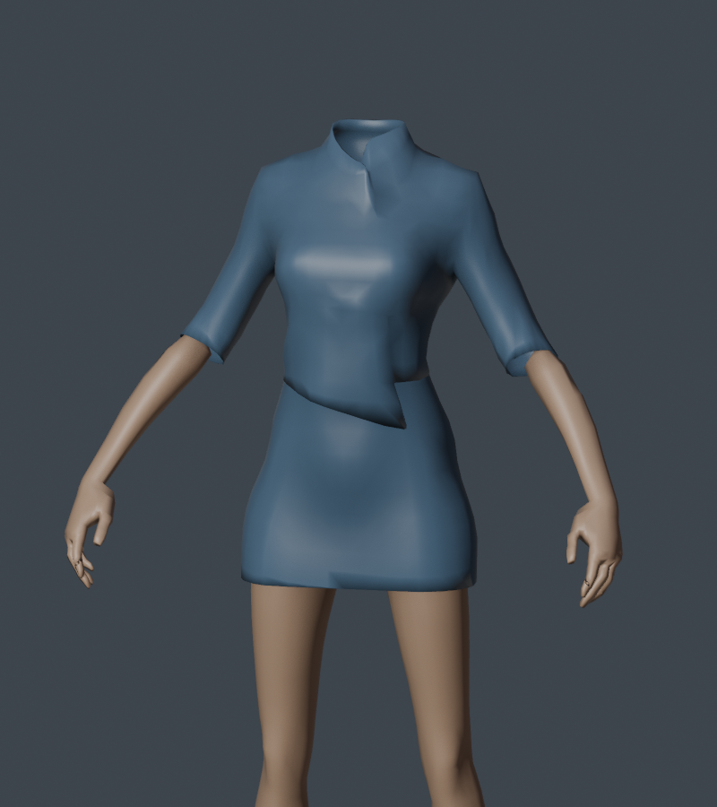

# Terran and Pioneer Short Skirts — 1.1

[Download version 1.1](Terran_Pioneer_Short_Skirts_v1.1.zip)

Female Terran and Pioneer crew/diplomat outfits now have elbow-length sleeves with fitted Argon civilian lower arms and hands. All four skirts are **another 1½ inches (3.81 cm) shorter than version 1.0**. The original shoulders, legs, shoes and skeletons remain. No crop-top clothing is included; pilot suits are unchanged.

## Install or update

Close X4. Extract the ZIP and copy `terran_pioneer_short_skirts` into `X4 Foundations/extensions`, replacing the existing mod files. Keep **Terran and Pioneer Short Skirts** enabled. Requires Cradle of Humanity.

## Preview

Blender geometry preview with simplified colors, not an in-game screenshot.

## Validation and limitations

All four exported models passed archive, skeleton, mesh index, finite-coordinate and normalized skin-weight checks and were reimported in Blender. The new skirt hems are closed against their lining. Standing and bent-arm geometry previews were checked. **Not yet tested in-game**: inspect walking, gestures and skin matching after restarting X4. [Validation report](validation.json).

The donor supplies light and dark skin textures. The adaptive arm material uses the light donor texture for the third skin palette, so exact matching across all NPC complexions is not guaranteed. As in 1.0, distant LODs are removed, so full-detail bodies remain at distance. Other mods replacing these same bodies can conflict.

[Full installation notes](README.txt) · [Previous version 1.0](Terran_Pioneer_Short_Skirts_v1.0.zip)
