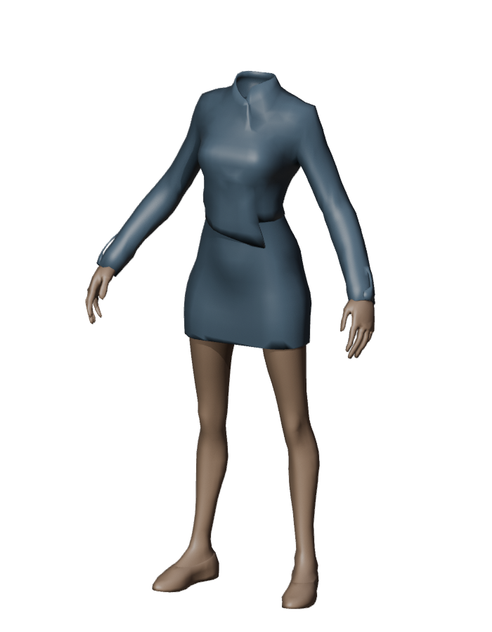

# Terran and Pioneer Short Skirts — 1.0

[Download the installable mod](Terran_Pioneer_Short_Skirts_v1.0.zip)

Shortens the four female Terran/Pioneer crew and diplomatic skirt models to mid-thigh. Includes edited XAC assets packaged as an X4 extension. Requires Cradle of Humanity. Sleeves are unchanged.

## Install

Extract the ZIP and copy `terran_pioneer_short_skirts` into your `X4 Foundations/extensions` folder. Enable **Terran and Pioneer Short Skirts** in the game's Extensions menu.

## Preview

Blender geometry preview with simplified colors; the mod retains the original game materials.

## Validation and compatibility

All four exported models were reimported and rendered in Blender. Archive checksums, skeletons, materials, untouched meshes, triangle indices and normalized bone weights passed checks. **Not yet tested in-game.** Check walking and standing NPCs for clipping. [Validation report](validation.json).

The original long-skirt distance meshes are removed, so the edited full-detail models remain visible at every distance. This can modestly increase rendering cost. Other mods replacing these same body assets may conflict. Remove this extension to restore the original outfits.

[Full installation and release notes](README.txt)
