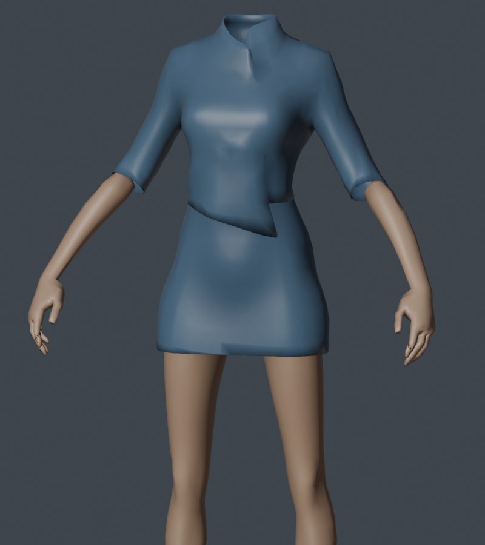

# Terran and Pioneer Short Skirts — 1.2

[Download version 1.2](Terran_Pioneer_Short_Skirts_v1.2.zip)

Adds the missing **hips, pelvis and upper thighs beneath the skirts** for all four female Terran/Pioneer crew and diplomat outfits. The lower-body fill joins the original thighs and uses the existing Terran leg skin material and skeleton.

The skirt length, finished hems, tops, elbow-length sleeves and fitted Argon lower arms from version 1.1 are unchanged. No pilot suits or character assignments are changed.

## Install or update

Close X4. Extract the ZIP and copy `terran_pioneer_short_skirts` into `X4 Foundations/extensions`, replacing the existing files. Keep the same mod enabled. Requires Cradle of Humanity.

## Preview

Blender geometry preview with simplified colors, not an in-game screenshot. The added body is concealed beneath the existing outfit.

## Validation

All four exported lower-body meshes reimported successfully and have no open or nonmanifold edges. Original skeletons/materials remain; skirt, top and arm meshes are unchanged; original leg vertex positions are preserved. Finite coordinates, triangle indices, normalized weights and archive integrity were checked. Standing and representative walking-pose geometry previews were reviewed. [Validation details](validation.json).

**Version 1.2 still needs an in-game animation/clipping check.** The concealed addition uses an extended upper-thigh skin UV strip. Version 1.1's forearm palette limitations and full-detail-at-distance behavior remain. Other replacements of these same bodies may conflict.

[Full release notes](README.txt) · [Previous version 1.1](Terran_Pioneer_Short_Skirts_v1.1.zip) · [Version 1.0](Terran_Pioneer_Short_Skirts_v1.0.zip)
