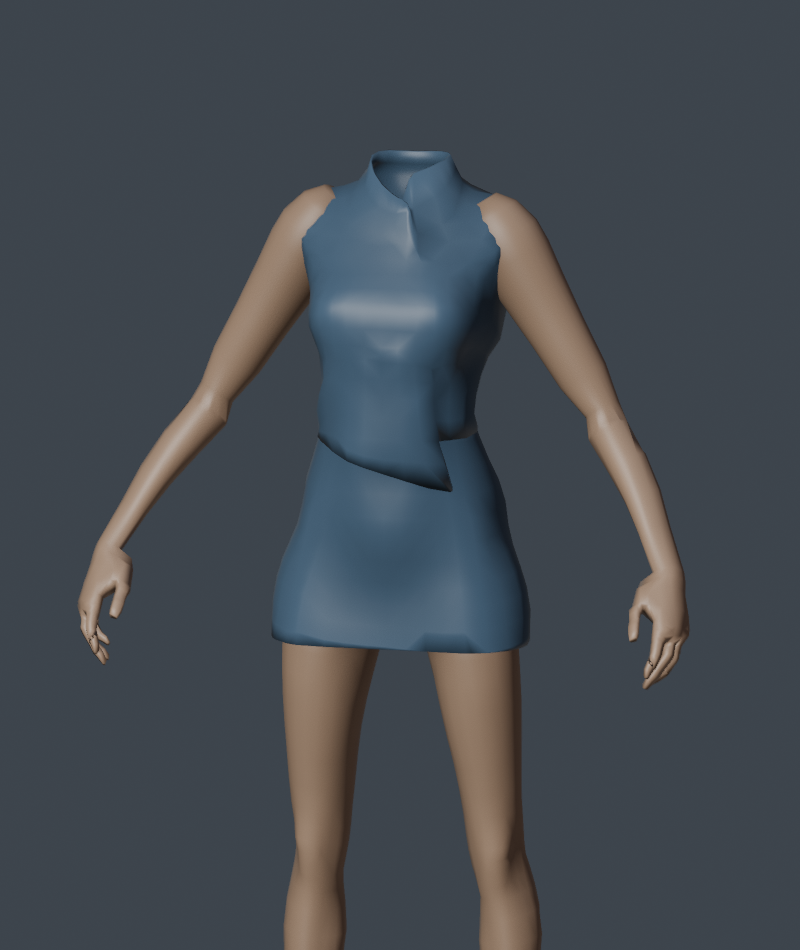

# Current installed release — 16 November 2026

[Terran and Pioneer Short Skirts: download current release](terran_pioneer_short_skirts_latest.zip)

Content version: **130**. This ZIP and the source folder match the verified local installation. No other Vardath mod is required.

External dependencies: ego_dlc_terran (required)

[Exact file checksums and requirements](CURRENT_RELEASE.json). [Compatibility and independence audit](../x4-updates/COMPATIBILITY_AND_INDEPENDENCE_2026-11-16.md).

Restart X4 after replacing an installed extension. Static checks passed; in-game verification of the newest fixes is pending. Older downloads below are retained for reference.

---

# Terran and Pioneer Short Skirts — 1.3

[Download version 1.3](Terran_Pioneer_Short_Skirts_v1.3.zip)

All four female Terran/Pioneer crew and diplomat outfits now have **sleeveless tops with built upper arms and shoulders**. The fitted lower arms remain, and the armholes have finished edges and revised clothing weights.

The skirts are **another inch (2.54 cm) shorter than version 1.2**. The completed hips, pelvis, upper thighs and legs from version 1.2 remain unchanged. Pilot suits are unchanged.

## Install or update

Close X4. Extract the ZIP and copy `terran_pioneer_short_skirts` into `X4 Foundations/extensions`, replacing the existing files. Keep the same mod enabled. Requires Cradle of Humanity.

## Preview

Blender geometry preview using simplified colors, not an in-game screenshot.

## Validation

All four exported models reimported successfully. Every body and clothing mesh is closed and manifold. Original skeletons/materials and the completed lower body are unchanged. Finite coordinates, triangle indices, normalized skin weights, the 2.54 cm hem change and archive integrity were checked. Representative front, side, rear and raised-arm geometry previews were reviewed. [Validation details](validation.json).

**Version 1.3 still needs an in-game animation and clipping check.** Upper-arm skin extends the donor forearm UV strip. Existing adaptive-skin palette limitations and full-detail-at-distance behavior remain. Other replacements of these same bodies may conflict.

[Full release notes](README.txt) · [Previous version 1.2](Terran_Pioneer_Short_Skirts_v1.2.zip) · [Version 1.1](Terran_Pioneer_Short_Skirts_v1.1.zip)
